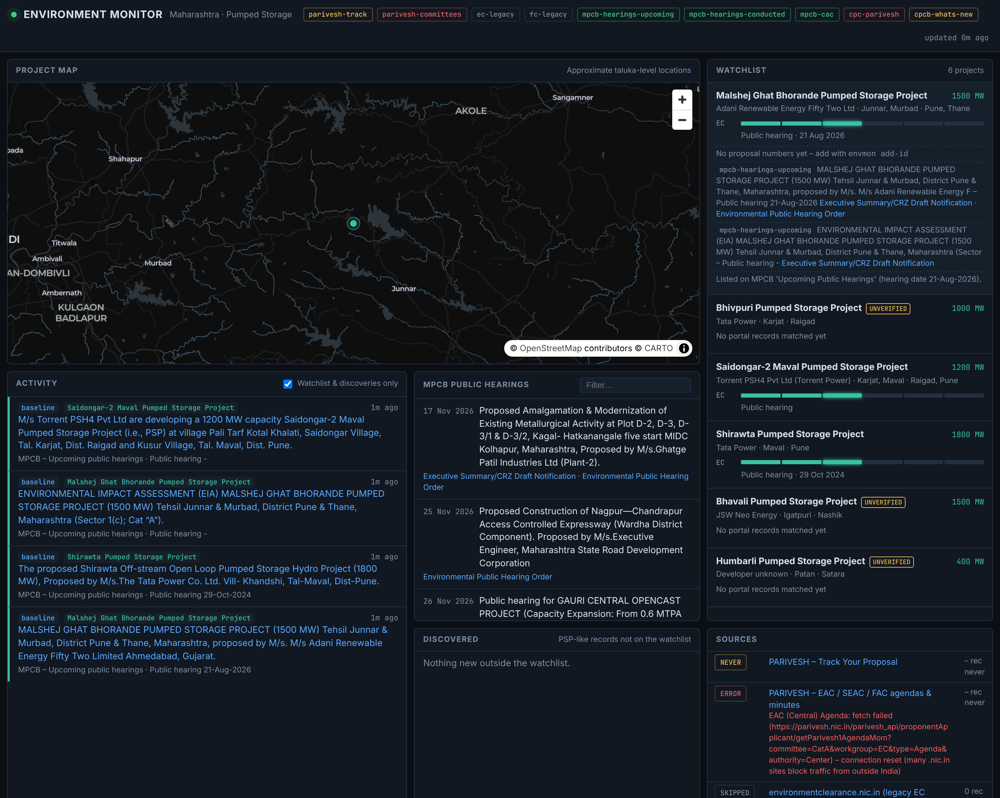
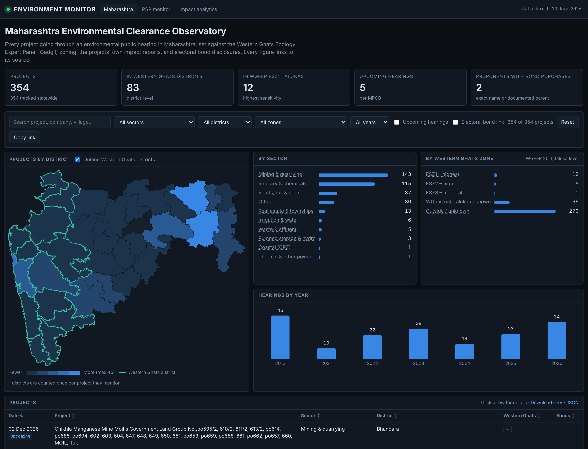
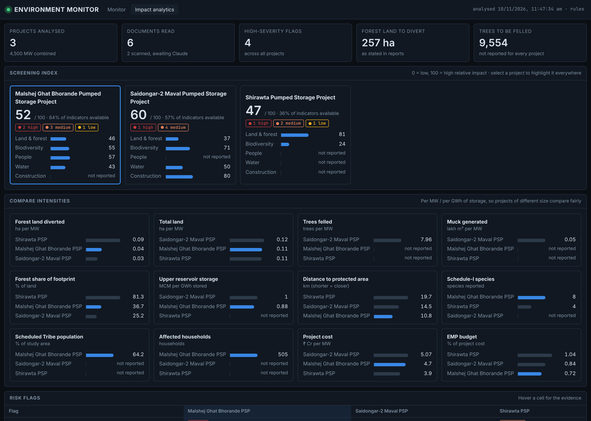

# Environment Monitor

Tracks Indian environmental approvals – **EIA / EC, ToR, Forest Clearance, Wildlife, CRZ and
State Pollution Control Board consents** – across PARIVESH, the legacy MoEFCC portals, MPCB and
CPCB. It watches a list of projects, records every change it sees, sends alerts and shows
everything on a map dashboard (layout inspired by [World Monitor](https://github.com/koala73/worldmonitor)).

**First focus: pumped storage projects (PSPs) in Maharashtra.**



## What it monitors

| Source | What it reads | How | Tested |
|---|---|---|---|
| [PARIVESH – Track Your Proposal](https://parivesh.nic.in/newupgrade/#/trackYourProposal) | Proposal status by proposal number (IA/…, SIA/…, FP/…, WL/…) or by name | Headless browser drives the real page and captures its JSON responses | Parsing tested; site was unreachable from the build machine |
| PARIVESH committees | EAC / SEAC / FAC / REC / Wildlife / CRZ agendas & minutes | Public JSON API `parivesh_api/proponentApplicant/getParivesh1AgendaMom` | Parsing tested; site unreachable from the build machine |
| [environmentclearance.nic.in](https://environmentclearance.nic.in/default.aspx) | Legacy EC proposals (pre-PARIVESH 2.0) | ASP.NET form replay on `Search.aspx` | Parsing tested only |
| [EC uploaded minutes](https://environmentclearance.nic.in/report_uploaded_minutes.aspx) | Minutes of EAC/SEAC meetings; **weekly**. Each new minutes PDF is downloaded once and searched for watchlist names, proposal numbers and pumped-storage terms (page + snippet saved in `data/minutes-scans.json`), so a project mentioned in minutes raises an alert | ASP.NET grid + pager postbacks, PDF text search | Tested on a GridView fixture and a local end-to-end run; live site returned 503 / incomplete certificate chain from the build machine |
| [forestsclearance.nic.in](https://forestsclearance.nic.in/PartIIReport_A.aspx) | Legacy FC proposal reports (`viewreport.aspx`, `PartIIReport_A.aspx`) | Report page by `?pid=` | Parsing tested only |
| [MPCB](https://www.mpcb.gov.in/en/public-hearing-upcoming) | Upcoming + conducted **EIA public hearings**, Consent Appraisal Committee meetings | HTML tables | ✅ Live |
| [cpc.parivesh.nic.in](https://cpc.parivesh.nic.in/), [CPCB](https://cpcb.nic.in/) | Any new link / notice on the page | Generic page watcher | Needs `caFile` (see below) |

The MPCB connector already finds three Maharashtra PSPs in live data: Malshej Ghat Bhorande
(Adani, 1500 MW), Shirawta (Tata Power, 1800 MW) and Saidongar-2 Maval (Torrent, 1200 MW).

## Quick start

```bash
npm install
npx playwright install chromium   # needed for the PARIVESH Track Your Proposal source
npm run monitor                   # run every source that is due
npm run serve                     # dashboard at http://localhost:8787
```

Keep it running and re-checking every hour:

```bash
npm run serve -- --monitor 60
```

### Run it from India

PARIVESH, CPCB and most `*.nic.in` portals reset connections from outside India. Run the
monitor on a machine or VM in India (a laptop, a small Indian cloud region VM, or a
self-hosted GitHub Actions runner). From elsewhere only the MPCB sources will work, and the
dashboard will show the others as `ERROR` with the reason.

## Maharashtra public dashboard

`web/maharashtra.html` is a public observatory of every project going through an environmental
public hearing in Maharashtra (354 at the last build), built by `node src/cli.js statewide`.



- **Filter and share**: search, sector, district (click the map), Western Ghats zone, year, upcoming hearings, bond links. The filters are kept in the URL, so a filtered view can be shared as a link. Export as CSV or JSON.
- **Western Ghats lens**: every project is placed against the **Gadgil (WGEEP, 2011) taluka zoning** (ESZ1/2/3), taken from the report's Appendices 2–3, with the panel's sector guidelines (power, mining, polluting industry, roads) and its hydrological and biological context (Bhimashankar WLS, origin of the Krishna/Koyna/Bhima). Each point cites the report page. WGEEP's recommendations were not adopted into law; the dashboard shows them as the expert reference. Later Kasturirangan/HLWG and draft ESA notification facts are marked as secondary or unconfirmed until a primary source is added in [`config/western-ghats.json`](config/western-ghats.json).
- **PSP comparison**: report-level figures (forest, trees, dam height, protected-area distance, draft WG ESA status) next to the WGEEP zone of each project's talukas. All three PSPs analysed so far sit in ESZ1 talukas (Maval, Murbad), where WGEEP recommended no forest clearance and only small hydro (≤10 MW).
- **Electoral bonds**: purchases by project proponents, linked to the parties that encashed them through the unique bond numbers disclosed by ECI on 21 March 2024. Built by `node src/cli.js bonds` from a pinned CSV conversion. The build stops unless the row counts and totals match the ECI PDFs exactly (18,871 purchases, ₹12,155.51 Cr; 20,421 encashments, ₹12,769.09 Cr). Companies match only on an exact normalised name or a parent/subsidiary link documented with a citation in [`config/entities.json`](config/entities.json). For example, Torrent Power Ltd, parent of the Saidongar-2 proponent per its own EIA, bought ₹106.5 Cr. Searches that found nothing (Tata, Adani, JSW) are shown too. A bond purchase is lawful disclosure data and does not imply any link to a clearance decision.

## Impact analytics from report PDFs

`npm run analyze` (or `node src/cli.js analyze`) downloads every PDF linked to a watchlist project
(EIA/EMP executive summaries, public hearing orders, minutes, letters) and extracts about 50
impact figures: land and forest diversion, trees felled, muck, reservoir storage and water use,
distance to protected areas, Western Ghats ESA / ESZ status, Schedule-I and threatened species,
affected households, tribal share, R&R, the full EMP budget table, project cost and baseline air
quality. **Every figure keeps the page number and the sentence it came from.**



From those figures it builds `data/analytics.json`, shown at `impact.html`:

- **Per-MW / per-GWh intensities**, so a 1200 MW and an 1800 MW project compare fairly (forest ha/MW, trees/MW, muck/MW, ₹ Cr/MW, EMP as % of cost…).
- **Risk flags with evidence**: protected area within 10 km, inside an ESZ or the draft Western Ghats ESA, large forest diversion, Schedule-I / endangered species, majority tribal area (FRA / PESA), displacement or affected households without an R&R plan, low EMP budget, seismic zone, heritage sites nearby, and disagreements between documents.
- **Screening index (0–100)** across land, biodiversity, people, water and construction, with a coverage figure showing how much of it is backed by data. Tune the reference levels and weights in [`config/analytics.json`](config/analytics.json). It is a way to compare projects, not a regulatory rating.
- **Reference numbers found in documents** (PARIVESH proposal numbers, MoEFCC file numbers, ToR IDs). Proposal numbers are added to the project automatically, so PARIVESH starts tracking them on the next run.

Two extractors feed it:

| | Rules (always on) | Claude (optional) |
|---|---|---|
| Needs | nothing | `ANTHROPIC_API_KEY` (model: `ENVMON_LLM_MODEL`, default `claude-opus-5-5`) |
| Reads | the PDF text layer | the PDF itself, **including scanned pages** |
| Gives | ~25–30 figures per executive summary + the EMP cost table | all ~50 figures, species lists, impact matrix with severity and mitigation, public-hearing concerns, EC/ToR conditions |

Claude's values take precedence; both are kept so disagreements can be flagged. Results are cached
per file in `data/extractions/`, so each PDF is read once (use `--force` to redo, `--no-llm` to skip Claude).

```bash
npm run analyze
```

## Adding your projects

The watchlist is [`config/projects.json`](config/projects.json). Each project has keywords
(matched against every source) and, once you know them, proposal numbers:

```bash
# Look a proposal up once (prints status and all fields PARIVESH returns)
npm run track -- IA/MH/RIV/123456/2025
npm run track -- "Bhivpuri"

# Attach it to a watchlist project so it is tracked on every run
node src/cli.js add-id bhivpuri-psp IA/MH/RIV/123456/2025
node src/cli.js add-id bhivpuri-psp FP/MH/HYD/12345/2019 --portal fcLegacy
```

Entries marked `"verified": false` are seeds from public announcements and still need a
proposal number confirmed on a portal.

**Discovery:** records anywhere that mention pumped storage *and* a Maharashtra place name,
but don't match a watchlist project, appear in the dashboard's *Discovered* panel and trigger
alerts. Edit `discovery` in `config/projects.json` to widen this (other states, other sectors).

## Alerts

Set any of these environment variables (or GitHub secrets for the workflow):

| Variable | Effect |
|---|---|
| `ENVMON_WEBHOOK_URL` | POST `{ text, events }` – works with Slack / Discord / Teams incoming webhooks |
| `ENVMON_TELEGRAM_TOKEN` + `ENVMON_TELEGRAM_CHAT_ID` | Telegram bot message |
| `ENVMON_NTFY_TOPIC` | Push via [ntfy](https://ntfy.sh), e.g. `https://ntfy.sh/my-psp-alerts` |

Alerts fire only for watchlist projects and discoveries, and never on a source's first run
(that run records the baseline).

## When PARIVESH changes

PARIVESH has no published API, so the Track Your Proposal connector doesn't hard-code one.
It opens the page in a headless browser, types the query, and reads whatever JSON the page
receives, falling back to the rendered table. To see exactly what the site does:

```bash
npm run probe -- IA/MH/RIV/123456/2025            # add --headed to watch the browser
```

This prints every network call and saves a full dump to `data/raw/parivesh-track/`.
Endpoints seen during normal runs are also logged to `data/raw/parivesh-track/endpoints.json`.
If the search box moves, adjust `searchInputSelectors` in `config/sources.json`.

## Certificate errors

Some `*.nic.in` servers don't send their intermediate certificate. TLS verification is never
disabled; instead add the intermediate as described in [`certs/README.md`](certs/README.md) and
point the source's `caFile` at it.

## Scheduled runs on GitHub

[`.github/workflows/monitor.yml`](.github/workflows/monitor.yml) runs twice a day and commits
`data/` back to the repo. GitHub-hosted runners are outside India, so for full coverage
register a self-hosted runner in India and set the repository variable
`ENVMON_RUNNER=self-hosted`.

## Public dashboard on GitHub Pages

[`.github/workflows/pages.yml`](.github/workflows/pages.yml) publishes `web/` together with the
latest `data/dashboard.json` to GitHub Pages. It redeploys after every `monitor` run, whenever
the site or data changes, or on demand from the Actions tab.

One-time setup: **Settings → Pages → Build and deployment → Source: GitHub Actions**.
The site is then at `https://<owner>.github.io/<repo>/`. By default the `github-pages`
environment only deploys from the default branch, so merge to it first (or allow your branch
under **Settings → Environments → github-pages**).

The Pages copy is read-only: it shows whatever the last monitor run committed.

## How it works

```
config/sources.json ──► connectors/*  ──► records ──► match to watchlist / discovery
                                                     │
data/snapshots/<source>.json ◄── diff against last run ──► data/events.json ──► alerts
                                                     │
                                         data/dashboard.json ──► web/ (map + panels)
```

- `src/connectors/` – one file per portal; each returns plain records `{ key, title, status, date, proposalNo, docs, fields }`.
- `src/lib/stages.js` – maps free-text statuses onto common stages per track (EC: ToR → public hearing → appraisal → EC granted; FC: Stage-I → Stage-II; WL; CRZ; PCB consent).
- `src/monitor.js` – runs due sources, diffs against the last snapshot, writes events, sends alerts.
- `src/dashboard.js` + `web/` – one JSON file and a static page (MapLibre map, watchlist with stage bars, activity feed, MPCB hearings, discoveries, source health).
- `src/statewide/` – statewide project list, sector/district/taluka detection, WGEEP zoning; `src/bonds/` – electoral bond build (verified against ECI totals) and company matching; `web/maharashtra.html` shows the result.
- `src/analysis/` – PDF download and text extraction, rule and Claude extractors, analytics (merge, intensities, flags, index); `web/impact.html` shows the result.

```bash
npm test     # parsers (including real MPCB pages), stage rules, matching and diffing
```

## Next steps

- Confirm PARIVESH proposal numbers for the seed projects (run `track` from India).
- Run `analyze` on EAC/SEAC/FAC agenda and minutes PDFs too, so projects are matched by the items listed, not just the meeting title.
- More SPCBs (Gujarat, Karnataka, Andhra Pradesh, Madhya Pradesh) and more project types.
